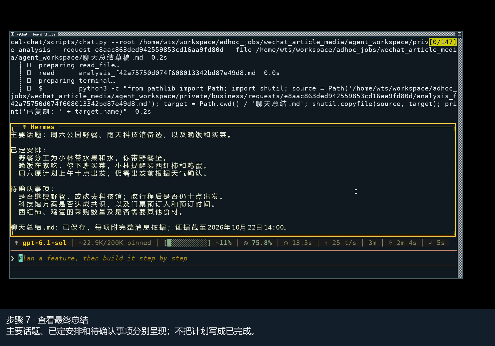

# WeChat local chat

An AI Skill that turns your own WeChat conversations into searchable records, actionable summaries and Markdown reports with message citations.

把本人微信聊天整理成可搜索记录、事项总结和消息可追溯 Markdown 报告的 AI Skill。

[English](#english) · [中文](#中文) · [Video / 操作视频](references/video_walkthrough.md)

## English

### What you can do

Tell your Agent whose conversation to use, the time range and your question. It can find a past decision, search a keyword, extract project follow-ups or summarize agreed and unresolved items. Each saved report cites the messages behind its claims, so you can check the evidence instead of relying on a summary alone.

This is a WeChat source component for your personal information workflow, not a complete general-purpose knowledge-base builder. It saves records and reports locally; it does not automatically import them into a Wiki.

One complete Skill handles setup, collection, search, evidence preparation and report saving. You do not need a separate decryption Skill, security Skill, HTTP service or model plugin. It uses the AI you have already authorized for reasoning.

**Tested on Windows WeChat 4.1.15.56 x64**, using WSL Python to invoke the Windows toolchain. Live main-database collection, decryption, conversation filtering and cited-report saving have been exercised. Other WeChat versions and the native Windows Python route have not been live-validated. [Verification record](references/verification.md).

### Watch the workflow

[](https://github.com/tsetwf-cloud/wechat-local-chat/releases/download/tutorial-v0.1.1/wechat_skill_operation.mp4)

[Watch / download the captioned video](https://github.com/tsetwf-cloud/wechat-local-chat/releases/download/tutorial-v0.1.1/wechat_skill_operation.mp4) · [Original recording and files](https://github.com/tsetwf-cloud/wechat-local-chat/releases/tag/tutorial-v0.1.1) · [Bilingual walkthrough and provenance](references/video_walkthrough.md)

The 213.12-second recording shows a real Hermes conversation: describe a task, load this Skill, generate a report, ask a follow-up and open the saved result. It uses nine synthetic messages in a saved snapshot, not live Windows WeChat collection. Inputs are automated and model replies were generated during recording. The screen and video callouts are Chinese; the linked guide explains every step in English and Chinese. The video is silent and preserves waiting time. First-run installation and live capture are not recorded.

### Install and get your first result

**Prerequisites:** Windows x64, your own logged-in WeChat 4.1.15.56 x64, Python 3.11+, and the Windows built-in .NET Framework compiler. WSL needs Windows interoperability. Python's pinned decoding dependency is installed during setup. You do not provide a WeChat password or save a decryption key in configuration.

For Hermes, run this in a terminal from any directory. Install the complete repository, not just `SKILL.md`:

```bash
hermes skills install tsetwf-cloud/wechat-local-chat/ --yes
```

Do not use `--force` to bypass a blocked source review. Keep the error and review the cause first. In a new Agent conversation, ask:

```text
Use wechat-local-chat and guide me through first-time setup.
```

The Agent checks the environment, sets up the dependency, asks you to confirm your account identifier and exact `db_storage` directory, then compiles and tests the local helper. Personal configuration stays outside the installed package; no source-code editing is needed.

After setup, send a task to the Agent, not to your shell:

```text
Collect my conversation with Zhang San from October 1 to October 20, 2026.
List project follow-ups and cite the supporting messages for each item.
```

Other examples:

```text
Search my conversation with Li Si yesterday from 14:00 to 18:00 for “delivery”. Do not analyze it.
Reuse the previous request without recapturing. Separate confirmed decisions from open questions.
```

Expect a scoped request ID and, when analysis is requested, a local Markdown report with message citations and coverage metadata. Exact remarks, nicknames or account names determine identity; duplicate names require your confirmation. Dates use UTC+8: an end date includes that day, while an exact end time is exclusive. Requests have independent IDs, and new captures do not overwrite old reports.

For another Agent that supports Skills, retain the entire directory and have it read `SKILL.md`, including `scripts/`, `tests/` and `requirements.txt`. Installation on every Agent platform has not been validated.

### Privacy and coverage

Collection, decryption, search and saving run locally without chat-upload, WeChat-sending or model-service calls in these scripts. Dependency installation can download a Python package. **If you use a cloud AI, the selected evidence enters that AI's context. Local collection does not mean offline analysis.** Use your own account and only data you are authorized to process.

Your private root retains encrypted copies, plaintext snapshots, conversation archives, requests, evidence and reports. A snapshot may hold underlying data from multiple contacts even though the Agent may read only the requested evidence. There is no automatic cleanup. ACLs are access controls, not encryption or protection against administrators or a compromised machine.

- Main databases only: recent WAL-only messages may be missing; no fixed waiting time guarantees completeness.
- Images, audio, video and attachment bodies are not read. A filename is not file content.
- Deleted messages and phone-only or unsynced history are not recovered.
- Stable per-file copying and SQLite checks do not prove complete history or an atomic cross-database snapshot.
- Matching the Windows SID does not prove that an account matches a source directory; you must confirm it.
- The Skill does not automatically elevate, inject into WeChat, write source databases, force checkpoints, send messages, schedule collection, upload reports or merge into a Wiki.

**0.1.1 correction:** version 0.1.0 could mix historic messages into current evidence when a source SQLite row was reused. Version 0.1.1 selects current records by stable identity. Old requests and reports do not change automatically; update, recollect the original authorized scope and regenerate potentially affected reports. [Details](references/verification.md).

### Manual commands and tests

These are terminal commands. Replace placeholders with your installed Skill directory, approved account/source and task. `python` means your actual Python 3.11+ interpreter; after bootstrap, use its returned interpreter. Commands can run from any directory.

```text
python <SKILL_DIR>/scripts/chat.py doctor
python <SKILL_DIR>/scripts/bootstrap.py --check
python <SKILL_DIR>/scripts/bootstrap.py
python <SKILL_DIR>/scripts/chat.py init --account YOUR_ACCOUNT --source YOUR_DB_STORAGE
python <SKILL_DIR>/scripts/chat.py build --test
python <SKILL_DIR>/scripts/chat.py collect --name NAME --start YYYY-MM-DD --end YYYY-MM-DD --question TASK
python <SKILL_DIR>/scripts/chat.py context --request REQUEST_ID
python <SKILL_DIR>/scripts/chat.py search --request REQUEST_ID --keyword KEYWORD
python <SKILL_DIR>/scripts/chat.py save-analysis --request REQUEST_ID --file DRAFT.md
python <SKILL_DIR>/scripts/chat.py history
python <SKILL_DIR>/scripts/test.py
```

For a separate data directory, put `--root <PRIVATE_ROOT>` before each `chat.py` subcommand and pass the same root to bootstrap. `collect --snapshot DIRECTORY` explicitly reuses approved saved data, not fresh collection. See `--help` for full syntax. Citations use the exact token `[消息:FULL_64_HEX_ID]`; saving checks that IDs belong to this request, not that every claim is correct.

Python tests use synthetic data. `build --test` runs synthetic Windows cryptographic/security fixtures, not real process capture. Actual capture requires separate account-owner authorization. See the [verification record](references/verification.md) for measured results, [architecture](references/architecture.md) for file roles, [security](references/security.md), [troubleshooting](references/troubleshooting.md), and [sources](references/sources.md).

### License

Original project code, documentation and project-created media use the [MIT License](LICENSE). Third-party software, interface assets and fonts retain their own rights; see [sources and media notices](references/sources.md). Official license texts remain in their original form. This project is not affiliated with Tencent. Follow applicable law and account/data-processing requirements.

## 中文

### 你能做什么

告诉 Agent 要看谁的聊天、哪段时间、解决什么问题，它可以找回过去的决定、搜索关键词、整理项目待办，或区分已确定事项和待确认问题。保存的报告会引用具体消息，你可以回到依据核对，而不是只接受 AI 的总结。

这是个人资料工作流中的微信数据组件，不是完整的通用个人资料库搭建工具。记录和报告保存在本地，不会自动导入 Wiki。

一个完整 Skill 负责配置、采集、检索、证据整理与报告保存。不需要另装解密 Skill、安全 Skill、HTTP 服务或模型插件，分析使用你已经授权的 AI。

**已在 Windows 微信 4.1.15.56 x64 实测通过**，实测路线为 WSL Python 调用 Windows 工具链，覆盖主数据库采集、解密、会话筛选和引用报告保存。其他微信版本和原生 Windows Python 路线尚未完成实时验收。[验证记录](references/verification.md)。

### 查看操作流程

[](https://github.com/tsetwf-cloud/wechat-local-chat/releases/download/tutorial-v0.1.1/wechat_skill_operation.mp4)

[观看／下载批注视频](https://github.com/tsetwf-cloud/wechat-local-chat/releases/download/tutorial-v0.1.1/wechat_skill_operation.mp4) · [连续原片与配套文件](https://github.com/tsetwf-cloud/wechat-local-chat/releases/tag/tutorial-v0.1.1) · [双语步骤与来源说明](references/video_walkthrough.md)

视频长 213.12 秒，展示真实 Hermes 对话：提出任务、加载此 Skill、生成报告、追问并打开保存结果。使用九条合成聊天的保存快照，不是 Windows 微信实时采集。输入由自动化完成，模型回复在录制时实际生成。画面和视频批注为中文，配套文档逐步提供英中说明。视频无声，保留真实等待；未录制首次安装配置及实时采集。

### 安装并得到第一个结果

**环境要求：**Windows x64、本人已登录的微信 4.1.15.56 x64、Python 3.11+ 和 Windows 自带 .NET Framework 编译器。WSL 需要 Windows 互操作可用。首次配置会安装固定版本的 Python 解码依赖，不需要提供微信密码，也不会将解密密钥保存到配置。

Hermes 用户可从任意目录在终端执行，安装完整仓库，而不是只下载 `SKILL.md`：

```bash
hermes skills install tsetwf-cloud/wechat-local-chat/ --yes
```

不要用 `--force` 绕过源码审查阻止，先保留错误并审查原因。在新 Agent 会话中说：

```text
使用 wechat-local-chat，帮我完成首次配置。
```

Agent 检查环境、准备依赖，请你确认本人的账号标识和准确的 `db_storage` 目录，再编译并测试本地程序。个人配置保存在安装目录外，不需要修改源码。

配置后向 Agent 提出任务，不是向终端输入：

```text
采集我与张三2026年10月1日至10月20日的聊天，整理项目待办，每项给出消息依据。
```

其他例子：

```text
搜索我与李四昨天14:00至18:00的聊天，只查“交付”，不要分析。
复用上次请求，不重新采集，区分已确定事项和待确认问题。
```

你会得到独立请求编号；要求分析时，还会得到包含消息引用和覆盖范围的本地 Markdown 报告。联系人按备注、昵称或账号精确匹配，遇到同名先由你确认。时间采用 UTC+8，结束日期包含当天，精确结束时刻不包含该时刻。每次请求独立，新采集不会覆盖旧报告。

其他支持 Skills 的 Agent 可以保留完整目录并读取 `SKILL.md`，需同时保留 `scripts/`、`tests/`、`requirements.txt` 等文件。尚未对每种 Agent 平台验证安装。

### 隐私与覆盖范围

采集、解密、检索和保存都在本地执行，这些脚本不上传聊天、不发送微信消息、不调用模型服务。安装依赖可能下载 Python 软件包。**如果你使用云端 AI，筛选后的聊天证据仍会进入该 AI 上下文。本地采集不等于离线分析。**只处理本人账号和自己有权处理的数据。

私有根目录保留加密副本、明文快照、聊天归档、请求、证据与报告。底层快照可能包含多个联系人的数据，但 Agent 只能读取本次明确范围的证据。没有自动清理。ACL 是访问控制，不是加密，也不能抵抗管理员或已失陷主机。

- 只处理主数据库：近期仍在 WAL 的消息可能缺失，没有固定等待时长保证完整。
- 不读取图片、语音、视频和附件正文，文件名不等于文件内容。
- 不恢复已删除消息，不读取手机独有或尚未同步记录。
- 逐文件稳定复制和 SQLite 检查不证明历史完整，也不等于跨库原子快照。
- Windows SID 匹配不能证明微信账号与源目录对应，仍需本人确认。
- 不自动提权、注入微信、写源数据库、强制 checkpoint、发送消息、定时采集、上传报告或合入 Wiki。

**0.1.1 修复提示：**0.1.0 在 SQLite 源行号复用时可能把历史消息混入当前证据。0.1.1 已改为按稳定标识选择当前记录。旧请求和报告不会自动修正；对于可能受影响的结果，应更新后重新采集原授权范围并生成报告。[修复说明](references/verification.md)。

### 手动命令与测试

以下是终端命令。替换安装目录、本人批准的账号路径和任务参数。`python` 指实际 Python 3.11+ 解释器，bootstrap 后使用它返回的解释器。可以从任意目录执行。

```text
python <SKILL_DIR>/scripts/chat.py doctor
python <SKILL_DIR>/scripts/bootstrap.py --check
python <SKILL_DIR>/scripts/bootstrap.py
python <SKILL_DIR>/scripts/chat.py init --account YOUR_ACCOUNT --source YOUR_DB_STORAGE
python <SKILL_DIR>/scripts/chat.py build --test
python <SKILL_DIR>/scripts/chat.py collect --name NAME --start YYYY-MM-DD --end YYYY-MM-DD --question TASK
python <SKILL_DIR>/scripts/chat.py context --request REQUEST_ID
python <SKILL_DIR>/scripts/chat.py search --request REQUEST_ID --keyword KEYWORD
python <SKILL_DIR>/scripts/chat.py save-analysis --request REQUEST_ID --file DRAFT.md
python <SKILL_DIR>/scripts/chat.py history
python <SKILL_DIR>/scripts/test.py
```

使用独立数据目录时，将 `--root <PRIVATE_ROOT>` 放在每个 `chat.py` 子命令之前，bootstrap 也使用相同 root。`collect --snapshot DIRECTORY` 明确复用已授权保存数据，不是新采集。完整语法见 `--help`。引用格式固定为 `[消息:FULL_64_HEX_ID]`；保存时检查 ID 是否属于本次请求，不自动证明每个结论正确。

Python 测试使用合成数据。`build --test` 执行 Windows 合成密码学与安全样本，不等于真实进程采集。真实采集需要账号本人另行授权。实测结果见[验证记录](references/verification.md)，文件职责见[架构](references/architecture.md)，另有[安全](references/security.md)、[排障](references/troubleshooting.md)和[来源](references/sources.md)说明。

### 许可

项目原创代码、文档和原创视频素材使用 [MIT License](LICENSE)。第三方软件、界面和字体仍保留各自权利，见[来源与视频声明](references/sources.md)。生效的法律许可文本保留原文。本项目与腾讯无隶属关系，使用时遵守当地法律及账号、数据处理要求。
